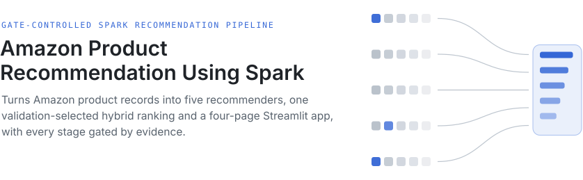
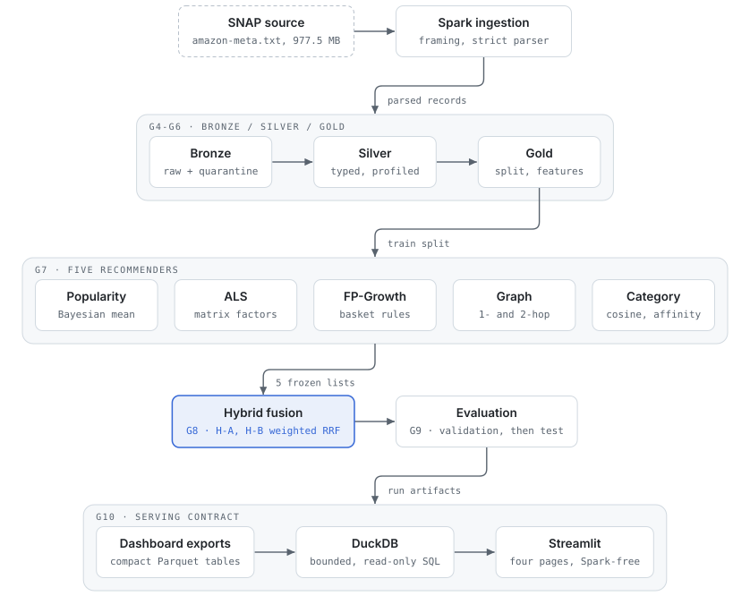
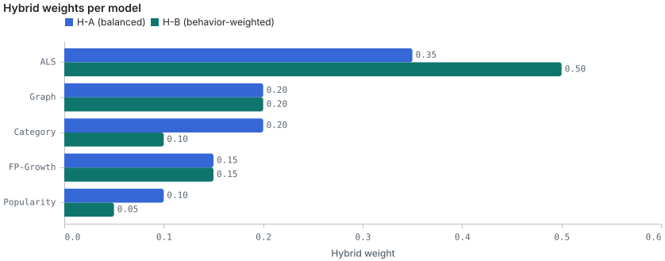
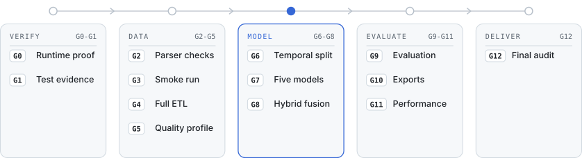

<picture>
  <source media="(prefers-color-scheme: dark)" srcset=".github/readme/assets/hero-dark.svg">
  <source media="(prefers-color-scheme: light)" srcset=".github/readme/assets/hero-light.svg">
  
</picture>

<p align="center">
  <a href="https://snap.stanford.edu/data/amazon-meta.html">SNAP dataset</a> &middot;
  <a href="#quickstart">Quickstart</a> &middot;
  <a href="#testing-and-verification">Testing</a> &middot;
  <a href="#license">License</a>
</p>

<p align="center"><code>Python 3.13.1 · Apache Spark 4.0.0 · GraphFrames 0.12.1 · MIT</code></p>

This project turns the SNAP `amazon-meta.txt` file into a controlled recommendation experiment. Apache Spark parses it into typed Bronze, Silver and Gold tables, five recommenders are trained and compared under one leakage-safe temporal protocol, and each stage must pass a fingerprinted gate before the next one can run.

The source is a 977.5 MB text file with blank-line delimited records, and some titles span physical lines. It combines product metadata, directed similar-product links, category hierarchies and historical ratings. Records are nested, discontinued products use a shorter record shape, and category labels carry bracketed ids. Malformed blocks must be kept and explained rather than silently discarded.

<picture>
  <source media="(prefers-color-scheme: dark)" srcset=".github/readme/assets/scale-stats-dark.svg">
  <source media="(prefers-color-scheme: light)" srcset=".github/readme/assets/scale-stats-light.svg">
  
</picture>

These are the counts that the G4 and G5 gates assert: expected values in the code, not outputs of a stored run, because run artifacts are git-ignored.

<details>
<summary>Contents</summary>

- [Highlights](#highlights)
- [Architecture](#architecture)
- [Quickstart](#quickstart)
- [Testing and verification](#testing-and-verification)
- [Scope and limitations](#scope-and-limitations)
- [License](#license)

</details>

## Highlights

- **Source-faithful ingestion** - Hadoop `TextInputFormat` splits the file on its blank-line record delimiter (CRLF CRLF), and malformed blocks go to quarantine with the error code, raw block, source offset, path and error detail.
- **Five complementary recommenders** - popularity, ALS, FP-Growth, graph and category models are trained from training data only, under one temporal split.
- **Deterministic hybrid ranking** - weighted reciprocal rank fusion with `c = 60` combines two weight sets, H-A and H-B. The winner is chosen on validation data only: higher NDCG@10 when the gap is at least 0.001, otherwise higher user coverage, otherwise H-A.
- **Thirteen gates with manifests** - each passed gate writes a JSON manifest with SHA-256 fingerprints, and a later gate is blocked by missing, failed or mismatched evidence.
- **Spark-free serving** - Streamlit reads run exports through DuckDB with 2 threads and a 384 MB memory limit, accepts read-only queries (`SELECT`, `WITH` or `DESCRIBE SELECT`) with bound parameters, and never imports PySpark.
- **Audited data quality** - a fixed taxonomy of 18 event types. 146,745 duplicate review occurrences are removed and reconciled, and 500 invalid sales ranks are counted as 459 plus 41.

## Architecture

<picture>
  <source media="(prefers-color-scheme: dark)" srcset=".github/readme/assets/architecture-flow-dark.svg">
  <source media="(prefers-color-scheme: light)" srcset=".github/readme/assets/architecture-flow-light.svg">
  
</picture>

<p align="center"><a href=".github/readme/assets/architecture-flow-light.svg">Open the full-size diagram</a></p>

Spark runs the expensive work before the application starts. Streamlit reads completed, run-scoped Parquet exports through DuckDB, so a page load, search or filter never starts a distributed job. The application serves only run directories that have a Spark `_SUCCESS` marker, and it never imports PySpark. NetworkX draws only deterministic ego layouts of at most 50 nodes; full graph analytics stay in GraphFrames.

The design keeps raw evidence next to typed tables, compares structurally different recommenders under one leakage-safe protocol, and makes every result explorable without starting Spark from the user interface.

### Five recommenders

The five models are independent candidate generators. Each produces its own ranked list, so raw scores on different scales never have to be compared directly.

| Model | Signal and candidates per user |
|---|---|
| Bayesian popularity | Weighted rating over the unique raters of each item. 100 candidates |
| ALS | Explicit-feedback latent factors: rank 20, regularization 0.10, 10 iterations, cold start dropped. 100 candidates (raw depth 200) |
| FP-Growth | Association rules from baskets of ratings of at least 4.0. 50 candidates |
| Graph | One-hop, reciprocal and two-hop paths in the similar-product graph. 50 candidates |
| Category | Blend of category-vector cosine (0.80), user group affinity (0.10) and popularity percentile (0.10). 50 candidates |

The Bayesian popularity score is `(n * item mean + 20 * global mean) / (n + 20)`, where `n` counts the unique raters of the item.

ALS and FP-Growth run on Spark MLlib, and graph analytics run on GraphFrames. Every model is fed from training data only. Candidates exclude items the user has already seen at that stage, and discontinued or out-of-catalog products.

### Parsing and reconciliation

Records are separated by a blank line (CRLF CRLF). The primary path reads them with Hadoop `TextInputFormat` and a 128 MiB split maximum, and an integration test covers split boundaries at that size. The fallback framer writes 64 integrity-checked JSONL shards, and each framed block stores its SHA-256. Blocks that fail parsing go to quarantine with the error code, raw block, source offset, source path and error detail. Quality events follow a fixed taxonomy of 18 types, including `PARSE_ERROR` and `MULTILINE_TITLE`. Valid but unusual values stay in the data and appear as quality events, separate from structural failures.

Product headers declare 7.781.990 reviews, while the downloaded source contains 7.593.244 physical review rows. Models start from the physical rows, and the declared total remains a data-quality signal.

<details>
<summary>Reconciliation counts</summary>

| Count | Value | Asserted by |
|---|---|---|
| Products | 548,552 = 542,684 active + 5,868 discontinued | G4, G5, G12 |
| Physical review rows | 7,593,244 | G4, G5 |
| Duplicate review occurrences removed | 146,745 | G5 |
| Deduplicated reviews | 7,446,499 = 7,593,244 - 146,745 | G5 |
| Products whose declared review total differs from the downloaded count | 8,615 above, 131 below | G5 |
| Products with zero declared review total | 139,949 | G5 |
| Invalid sales ranks | 500 = 459 at -1 plus 41 at 0 | G5 |
| Orphan graph targets | 172,790 ASINs referenced 557,286 times | G5 |

</details>

### Leakage-safe split and evaluation

| Set | Rule |
|---|---|
| Train | All earlier interactions |
| Validation | Penultimate interaction, position 2 from the end |
| Test | Latest interaction, position 1 from the end |

Interactions are ordered by interaction date and then product id. A user is evaluation-eligible with at least 5 distinct items. The test seen-set includes the validation item, while the model profile does not. ALS trains on a k-core universe of users with at least 3 items and items with at least 5 users.

Ranking uses NDCG@10, HitRate@10 and MRR@10. Coverage is reported as user coverage, fill rate at 10 and catalog coverage at 10. Users with empty recommendation lists stay in the denominator, so coverage loss cannot inflate ranking success. RMSE and MAE use raw, unclipped ALS predictions. Slices are overall, Book and non-Book, and no model is rerun per slice.

### Hybrid rank fusion

<picture>
  <source media="(prefers-color-scheme: dark)" srcset=".github/readme/assets/hybrid-weights-dark.svg">
  <source media="(prefers-color-scheme: light)" srcset=".github/readme/assets/hybrid-weights-light.svg">
  
</picture>

Each model adds its normalized weight divided by `60 + rank`, where `rank` is one-based and `c = 60`. Weights are renormalized over the models that produced candidates for each user, and contributions are folded in sorted model order. The fused list is ordered by hybrid score, contributing-model count, Bayesian score and ascending product id, and the top 100 are kept.

The winner is chosen from validation data only, on the `common_warm` cohort. The higher NDCG@10 wins when the gap is at least 0.001. Otherwise the higher user coverage wins, and otherwise H-A. The config loader rejects any weight set that does not sum to 1.

<details>
<summary>Exact weights</summary>

| Model | H-A (balanced) | H-B (behavior-weighted) |
|---|---:|---:|
| ALS | 0.35 | 0.50 |
| Graph | 0.20 | 0.20 |
| Category | 0.20 | 0.10 |
| FP-Growth | 0.15 | 0.15 |
| Popularity | 0.10 | 0.05 |
| Sum | 1.00 | 1.00 |

</details>

### Gates and manifests

<picture>
  <source media="(prefers-color-scheme: dark)" srcset=".github/readme/assets/gate-phases-dark.svg">
  <source media="(prefers-color-scheme: light)" srcset=".github/readme/assets/gate-phases-light.svg">
  
</picture>

The board above groups the thirteen ordered gates, G0 to G12, into five phases. G0 is a script (`scripts/g0_smoke.py`), G1 is built into the CLI, and phase handlers implement G2 to G12.

Gates G1 to G12 write a manifest to `artifacts/runs/$RUN_ID/manifests/G<n>.json` with the run id, the config and source SHA-256, prerequisite evidence digests and timing. G0 writes environment evidence (versions, hardware, GraphFrames JAR hashes and runtime tests) to its manifest at the same path, and the fingerprint check does not apply to G0. A gate is blocked when an earlier passed manifest, other than G0, has a different config or source fingerprint. A passed gate is reused unless `--force` is given.

`configs/project.yaml` fixes the source identity, seed, Spark settings, split rules and model parameters, and the configuration loader rejects changes to these binding values. Each published table records its row count, schema, file count, size and SHA-256.

Tables are written to a temporary directory, read back to count their rows, and renamed into place. A table path without `_SUCCESS` is treated as an interrupted workspace and rebuilt.

G12 is the final acceptance audit. It recomputes prior manifest and artifact fingerprints, reconstructs the frozen hybrid selection, verifies the official comparison matrix and this README, then publishes the delivery atomically and writes its success marker last.

The repository holds no measured results, so this section describes the performance protocol only. G11 compares `local[1]` with `local[min(4, logical cores)]`, runs 1 warm-up and 3 measured runs per condition, and disables dataset caching. Its output is `artifacts/runs/$RUN_ID/performance/summary.json`.

<details>
<summary>Gate reference</summary>

| Gate | Responsibility | Primary entry |
|---|---|---|
| G0 | Runtime proof: Parquet round trip, GraphFrames PageRank and WCC, durable checkpoint | `scripts/g0_smoke.py` |
| G1 | Passing JUnit evidence and the project command contract | `gate G1` |
| G2 | Parser and record-boundary contract | `gate G2` |
| G3 | Deterministic Bronze-to-Gold smoke pipeline | `gate G3` |
| G4 | Full-source ETL and canonical source counts | `gate G4` |
| G5 | Deduplication, interaction aggregation and quality profile | `gate G5` |
| G6 | Temporal split, cohorts, k-core and leakage checks | `gate G6` |
| G7 | Five independent model outputs | `gate G7` |
| G8 | Shared hybrid evidence and H-A and H-B rankings | `gate G8` |
| G9 | Validation freeze and official evaluation | `gate G9` |
| G10 | Spark-free dashboard exports and application contracts | `gate G10` |
| G11 | Controlled `local[1]` versus bounded multi-core experiment | `gate G11` |
| G12 | Independent acceptance audit and atomic delivery | `gate G12` |

</details>

### Bounded serving

The application is titled Catalog Observatory and has four pages under `app/`. Its UI copy is Turkish, while this README is English.

- **Home** (`Home.py`): scale, distributions, sparsity and quality events.
- **Product and Graph Explorer** (`2_Product_and_Graph_Explorer.py`): product metadata, taxonomy, PageRank, degree, weak components and a bounded first-degree graph.
- **Recommendation Lab** (`3_Recommendation_Lab.py`): customer, seed-product and category-onboarding recommendations with their evidence.
- **Model and Experiment Comparison** (`4_Model_and_Experiment_Comparison.py`): ranking and coverage metrics, ALS prediction metrics, model runtimes, local Spark performance and reproducibility metadata.

<details>
<summary>Serving bounds</summary>

- DuckDB runs with 2 threads and a 384 MB memory limit.
- Queries must start with `SELECT`, `WITH` or `DESCRIBE SELECT`, and user input is passed as bound parameters.
- Detail reads return at most 500 rows, and recommendation lists at most 100 rows.
- Bounded reads are cached for 600 seconds, in at most 512 entries.
- Only run directories with a Spark `_SUCCESS` marker are served, and only allowlisted logical tables.
- Recommendation Lab searches are limited to 20 customers and 30 categories, and its top-K slider runs from 1 to 50 in the customer section and from 1 to 30 in the seed-product and category sections, with a default of 10.
- The dashboard needs gates G0 to G10 to have passed; G11 and G12 are not needed to serve it.

</details>

## Technology stack

| Layer | Technologies and role |
|---|---|
| Language and runtime | Python 3.13.1, Java 21.0.11 and Scala 2.13.16. Application logic in Python, on the JVM and Scala runtime that Spark needs |
| Distributed processing | Apache Spark 4.0.0, PySpark and Spark SQL. Parsing, transformation, feature engineering, candidate generation and evaluation |
| Machine learning | Spark MLlib. Explicit-feedback ALS and FP-Growth training |
| Graph analytics | GraphFrames 0.12.1. PageRank, degrees, reciprocity and weakly connected components |
| Analytical storage | Parquet with Snappy and PyArrow 25.0.0. Typed, compressed tables with fingerprinted artifacts |
| Query layer | DuckDB 1.5.4. Bounded, read-only queries over completed Parquet exports |
| Application UI | Streamlit 1.59.1 and Plotly 6.9.0. Four-page interactive analytics application |
| Local helpers | pandas 2.3.0 and NetworkX 3.5. Bounded result shaping and small deterministic ego-graph layouts |
| Testing | pytest 9.1.1 and pytest-cov 7.1.0. Unit, Spark integration and contract tests |
| Configuration and automation | YAML, JSON, Make and Bash. Configuration, evidence manifests, repeatable commands and environment enforcement |

## Quickstart

Prerequisites:

- Linux with `pyenv` and the `pyenv-virtualenv` plugin.
- Python 3.13.1 in an environment named `bil401_env_1`. The launcher refuses any other interpreter.
- OpenJDK 21.0.11 at `/usr/lib/jvm/java-21-openjdk-amd64`. G0 records this Java version.
- At least 15 GiB of total memory, the baseline that G12 checks in the G0 evidence.
- At least 20 GiB of free disk for source data, Parquet outputs, models and publication workspaces.
- The SNAP source at `Dataset/amazon-meta.txt`, with this SHA-256 digest:

  ```text
  600135116a05b7ce2dcb7e842e892d663c6190a0567d00373e0c5c4f3c908f02
  ```

The dataset and generated run artifacts stay out of version control.

Run the pipeline in this order:

1. Create the locked environment once and install the project. `make bootstrap` runs `pip install -r requirements.lock -e .`; it does not fetch the GraphFrames JARs.

   ```bash
   pyenv install -s 3.13.1
   pyenv prefix bil401_env_1 >/dev/null 2>&1 \
     || pyenv virtualenv 3.13.1 bil401_env_1
   export JAVA_HOME=/usr/lib/jvm/java-21-openjdk-amd64
   make bootstrap
   ```

2. Cache the GraphFrames runtime JARs in `.cache/ivy/jars`, which is not committed. The copy loop also copies the datasketches JARs, although no code references them.

   ```bash
   PY="$(PYENV_VERSION=bil401_env_1 pyenv which python)"
   mkdir -p .cache/ivy/jars
   PYSPARK_PYTHON="$PY" PYSPARK_DRIVER_PYTHON="$PY" \
   PYSPARK_SUBMIT_ARGS='--packages io.graphframes:graphframes-spark4_2.13:0.12.1 pyspark-shell' \
   "$PY" -c 'from pyspark.sql import SparkSession; SparkSession.builder.getOrCreate().stop()'
   find "$HOME/.ivy2/jars" -maxdepth 1 -type f \
     \( -name 'io.graphframes_*.jar' -o -name 'org.apache.datasketches_*.jar' \) \
     -exec cp -n {} .cache/ivy/jars/ \;
   ```

3. Create the test evidence and the run id. This step runs only with the `bil401_env_1` interpreter that `scripts/run_tests_sharded.py` pins, so it does not run on other machines as written.

   ```bash
   export SOURCE8="$(sha256sum Dataset/amazon-meta.txt | cut -c1-8)"
   export RUN_ID="run-$(date -u +%Y%m%dT%H%M%SZ)-$SOURCE8"
   export JUNIT="artifacts/runs/$RUN_ID/test-results/preflight.xml"
   make test TEST_JUNIT="$JUNIT" \
     TEST_SHARD_DIR="artifacts/runs/$RUN_ID/test-results/shards"
   ```

4. Record the G0 runtime proof with the Spark settings that `bin/amazon-rec` passes to Spark, using its default values. G12 requires the recorded driver memory to be `8g`.

   ```bash
   export JARS="$(find .cache/ivy/jars -type f -name '*.jar' | sort | paste -sd, -)"
   export SPARK_LOCAL_IP=127.0.0.1
   export PYSPARK_SUBMIT_ARGS="--master local[*] --driver-memory 8g \
     --driver-java-options=-Duser.timezone=UTC \
     --conf spark.driver.host=127.0.0.1 \
     --conf spark.driver.bindAddress=127.0.0.1 \
     --conf spark.driver.maxResultSize=1g \
     --conf spark.ui.enabled=false \
     --conf spark.ui.showConsoleProgress=false \
     --conf spark.task.cpus=4 \
     --conf spark.memory.fraction=0.35 \
     --conf spark.memory.storageFraction=0.30 \
     --conf spark.sql.shuffle.partitions=64 \
     --conf spark.sql.adaptive.enabled=true \
     --conf spark.sql.files.maxPartitionBytes=134217728 \
     --conf spark.sql.parquet.compression.codec=snappy \
     --conf spark.sql.session.timeZone=UTC \
     --jars $JARS pyspark-shell"
   JAVA_HOME="$JAVA_HOME" PYSPARK_PYTHON="$PY" PYSPARK_DRIVER_PYTHON="$PY" \
     "$PY" scripts/g0_smoke.py --output "artifacts/runs/$RUN_ID/manifests/G0.json"
   ```

5. Run gates G1 to G12 in order, then print the chain status. Each gate receives the JUnit evidence file, and the loop stops at the first gate that does not pass.

   ```bash
   for gate_number in {1..12}; do
     ./bin/amazon-rec --run-id "$RUN_ID" gate "G${gate_number}" \
       --evidence-file "$JUNIT" || break
   done
   ./bin/amazon-rec --run-id "$RUN_ID" status
   ```

6. Open the dashboard once G0 to G10 have passed. Streamlit uses its default port, 8501.

   ```bash
   ./bin/amazon-rec --run-id "$RUN_ID" dashboard
   ```

<details>
<summary>Pin the dashboard address</summary>

With these variables set, the application is served at `http://127.0.0.1:8501`.

```bash
STREAMLIT_SERVER_HEADLESS=true \
STREAMLIT_SERVER_ADDRESS=127.0.0.1 \
STREAMLIT_SERVER_PORT=8501 \
STREAMLIT_BROWSER_GATHER_USAGE_STATS=false \
./bin/amazon-rec --run-id "$RUN_ID" dashboard
```

</details>

Notes:

- Run ids must match `^[A-Za-z0-9][A-Za-z0-9._-]{0,127}$`. Always pass `--run-id`; the CLI's built-in default is a dated run id that is not a current run.
- Exit code 3 means a gate is blocked by missing or incompatible prerequisites, and exit code 1 means it failed.
- A passed gate is reused unless `--force` is given before the subcommand.
- The `make` shortcuts do not pass `--evidence-file`, so this guide calls the CLI directly.

<details>
<summary>Project layout</summary>

```text
.
├── .github/readme/              # README visual spec and generated SVG assets
├── .gitignore                   # Ignored data, run artifacts and local state
├── .streamlit/                  # Streamlit theme configuration
├── app/                         # Streamlit pages and bounded DuckDB access
├── bin/amazon-rec               # Environment-enforcing command launcher
├── configs/project.yaml         # Source, Spark, model and experiment contract
├── LICENSE                      # MIT License
├── Makefile                     # Bootstrap, test and shortcut targets
├── pyproject.toml               # Package metadata and pinned versions
├── requirements.lock            # Locked runtime and test environment
├── scripts/                     # Dataset analysis, G0 proof and sharded tests
├── src/amazon_recommender/
│   ├── cli.py                   # Command interface for gates, aliases and status
│   ├── gate_handlers.py         # Registry of G2 to G12 phase handlers
│   ├── core/                    # Configuration, gates, manifests and paths
│   ├── ingestion/               # Delimiter framing, schemas and strict parser
│   ├── pipelines/               # Bronze/Silver/Gold transforms and atomic storage
│   ├── quality/                 # Data profiling and quality-event taxonomy
│   ├── features/                # Temporal split, cohorts, baskets and profiles
│   ├── models/                  # Five recommenders and hybrid rank fusion
│   ├── evaluation/              # Ranking, coverage and ALS prediction metrics
│   ├── performance/             # Fixed workload and experiment protocol
│   └── phases/                  # G2-G12 gate implementations
└── tests/                       # Unit and local Spark integration contracts
```

</details>

## Testing and verification

The suite contains 184 test cases in 31 test modules, across unit and local Spark integration tests. The sharded runner executes 12 sequential shards, 10 of them Spark, and merges their JUnit fragments with `scripts/merge_junit.py`. It refuses to start while another project Spark process is active.

Official outputs are written under `artifacts/runs/$RUN_ID/`:

- Gate manifests G0 to G12: `manifests/G0.json` through `manifests/G12.json`
- Model comparison: `data/g9/official_test_comparison/`
- Selection evidence: `data/g9/selected_hybrid/`
- Performance evidence: `performance/summary.json`
- Accepted delivery: `delivery/`

<details>
<summary>Test coverage areas</summary>

- CRLF and LF record framing, and mixed line endings fail closed.
- Hadoop split boundaries at 128 MiB.
- Hand-calculated association rules, category math and ranking metrics.
- Traversal-safe run ids: unsafe values such as `../escape`, absolute paths, spaces and empty ids are rejected.
- Parameterized, bounded DuckDB search.
- NetworkX layouts that are deterministic and never exceed 50 nodes.
- The Streamlit application never imports PySpark.
- An interrupted G11 run reuses only atomically completed trials.
- Canonical source counts: G5 accepts only the exact canonical counts, and the quality-event taxonomy contains every binding event once.
- Temporal split and leakage checks: G6 invariants reject held-out leakage and missing held-out users.
- Stable, seeded sampling of the smoke set.
- ALS recommendations are raw depth 200, then active and unseen items only, without fallback.
- Interruption-safe table publication: incomplete temporary publications are removed.
- Stable hybrid tie-breaking: all four deterministic ranking keys are applied.
- Validation-only selection: strict NDCG@10 threshold, then coverage, then H-A.
- Validation-only G9 selection, recomputed from frozen Parquet artifacts.
- G8 experiment budget: no refit, and a third variant is rejected.
- G12 recomputes every manifest digest and rejects tampered manifests and README placeholders.
- Binding configuration rejects parameter changes.
- Registered pytest markers: `unit`, `integration` and `slow`. `e2e` and `full_data` are registered but not yet applied.

</details>

## Scope and limitations

- The dataset and run artifacts are not in the repository, so the README shows configuration values and the counts that the gates assert, and no measured ranking results.
- The test runner and the configuration pin one interpreter path, so step 3 of the Quickstart runs only where that interpreter exists.

## License

The source code is available under the [MIT License](LICENSE). Copyright (c) 2026 Arda Tuz. The SNAP dataset retains its own source and citation terms; see the [SNAP dataset page](https://snap.stanford.edu/data/amazon-meta.html).
